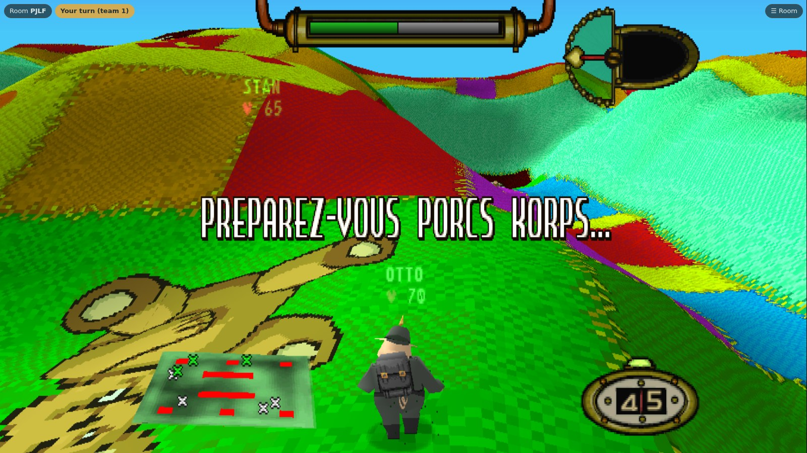
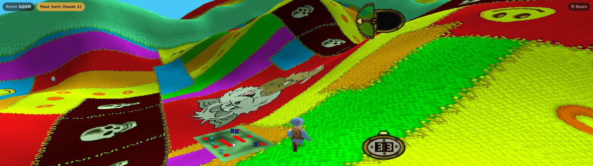
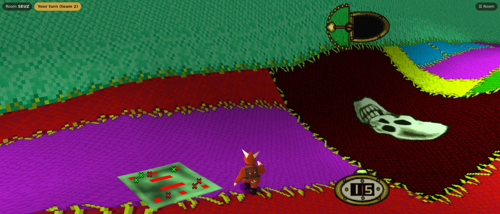
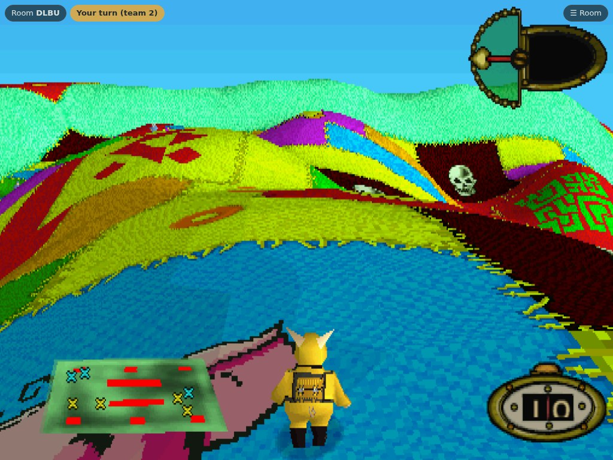
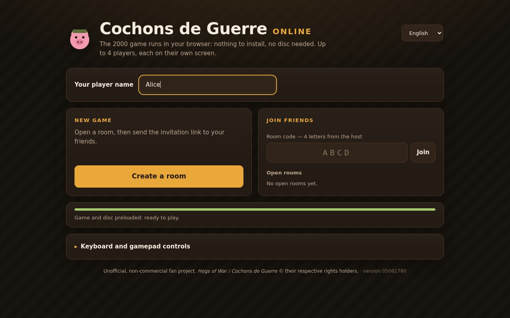
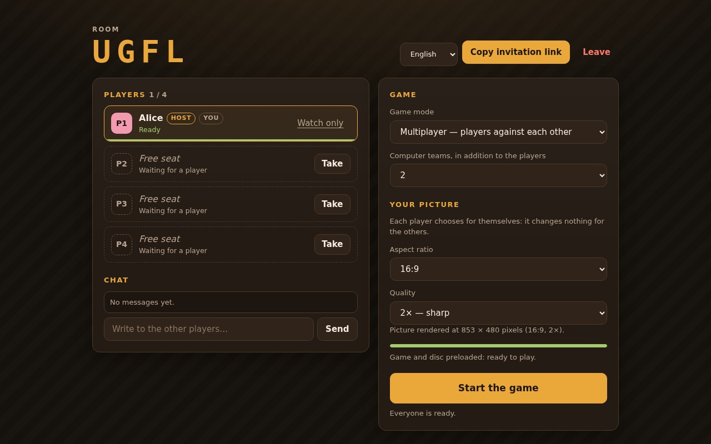

# Cochons de Guerre Online

The PlayStation game **Hogs of War** (*Cochons de Guerre*, Infogrames, 2000),
playable online with friends in the browser.

The project is based on the **French disc** of the game (PAL release, serial
**SLES-02766**), and only on that disc. Its code is translated to C by static
recompilation ([psxrecomp](https://github.com/RetroPortingToolKit/psxrecomp)),
then compiled to WebAssembly. Each player runs the game in their browser: the
PlayStation AI and the French text, voices and sounds are those of the disc.
The server sends the disc to the browsers and relays the players' inputs; the
players run in lockstep, so every browser computes exactly the same game.

## Features

### Playing online

- **Nothing to install for the players**: the game runs in the browser
  (WebAssembly). Only the person hosting the server needs the disc; the
  browsers receive it from the server, compressed, and can start before the
  preload is over.
- **Up to 4 teams in a battle**: up to 4 players, each on their own screen,
  and up to 3 computer teams.
- **Two game modes**:
  - **Multiplayer**: the players fight each other;
  - **Solo**: the campaign; the host plays and the others watch.
- **Rooms** with a 4-letter code and an **invitation link**, a list of open
  rooms, a chat, and a **"watch only"** seat for spectators.
- **Rejoin a running game**: a player who drops out comes back to their seat.
  Everyone else's copy of the game reloads the same snapshot and the battle
  goes on.
- **Real turn ownership**: each player sets up their own team and controls it
  only during their own turns; the others watch it live.
- **Lockstep**: every browser computes exactly the same game. The input delay
  follows the measured latency, and a slower machine never freezes the others
  for long.
- **Keyboard and gamepad**:
  - keys can be changed during the game;
  - key names follow the player's keyboard layout (QWERTY, AZERTY…);
  - gamepads are detected as soon as a button is pressed.
- **Web page in English or French**, following the browser's language, with a
  selector.
- Crash and stall reports are sent to the server log.

### Picture

Each player picks their own picture: it changes nothing for the others and
does not break the lockstep.

- **Aspect ratios**:
  - **Match my screen**: follows the window, anywhere from 4:3 to 32:9;
  - **4:3**, as on the PlayStation;
  - **16:10**;
  - **16:9**;
  - **21:9** (ultrawide);
  - **32:9** (super ultrawide, e.g. 5120 × 1440).
- **True widescreen**, not stretched: the 3D world is drawn wider.
  - Pigs, props and terrain appear in the extra side areas, and the sky
    backdrops are widened to fill them.
  - The sniper rifle and machine gun scopes keep their round view, with bars
    on both sides.
  - The full-motion videos and boot logos stay in 4:3.
- **Internal resolution from 1× to 4×**:
  - 1×: the PlayStation's own resolution (240 lines);
  - 2×: sharp;
  - 3×: very sharp;
  - 4×: for a powerful PC.
- Fullscreen.

### Changes to the game itself

- **Direct start**: the game boots straight into the mode chosen in the room
  ("Multijoueur" level selection, or the campaign). No logos, title or main
  menu.
- **Instant loading**: data files are copied straight into memory instead of
  going through the emulated CD drive. Speech, music and videos still stream
  as on the PlayStation.
- **Faster enemy AI**: the routine the computer teams use to judge every move
  and target ran for hundreds of milliseconds of emulated time per decision,
  freezing the picture. It now runs natively, with identical results, so the
  AI decides within the same frame.
- **Smooth scope aiming**: aiming through a scope no longer runs at half
  speed.

Everything else (gameplay, AI decisions, French text, voices and music) is the
original game, from the disc.

## Screenshots

A battle in 16:9: the hills, the backdrop and the sky reach the edges of the
screen.



Other battles in 32:9 (super ultrawide), 21:9 (ultrawide) and 4:3 (as on the
PlayStation):







The home page and a room, where each player picks their aspect ratio and
quality:

 

## Getting started

You need your own copy of the **French disc**: the `.cue` file, its three
`.bin` tracks and the `.sbi` file, or a `.zip` archive that holds them. The
`.sbi` is required: the French disc is LibCrypt-protected and, without this
file, the game does not behave like the original. No other release of the
game is accepted (the disc is checked).

```bash
git clone --recurse-submodules https://github.com/V1ck3s/hogs-of-war-web.git
cd hogs-of-war-web
# put your disc in the disc/ folder
./start.sh
```

Then open **http://localhost:8090**, create a room and send the invitation
link to your friends (to play outside your network, port 8090 must be
reachable from the Internet).

`start.sh` does the rest and only redoes what is missing or has changed:

1. extracts the disc if it is in a `.zip` archive;
2. installs missing system packages (it asks before using `sudo apt-get`)
   and, once, Emscripten (about 2 GB, in `.cache/emsdk`);
3. checks the disc, makes a working copy of it in `cochons/disc/` and
   translates the game code to C (`cochons/generated/`);
4. compiles the game to WebAssembly (`cochons/build-web/`), including the code
   the game loads during play, rebuilt from the disc
   (`cochons/tools/build_caps.py`);
5. prepares the files sent to the browsers (`online/game/`) and starts the
   server.

The first run takes 20 minutes to an hour depending on the machine. If the
script is interrupted, run it again: it picks up where it stopped. After that,
it starts the server in a few seconds.

System: Linux (tested on Debian 13), at least 2 GB of memory and about 6 GB of
disk space. The packages used are `git python3 cmake ninja-build clang nodejs
npm xz-utils bzip2` (Python 3.11 and Node.js 18 or newer).

Useful variables: `PORT` (8090), `HOST` (0.0.0.0), `CDG_JOBS` (parallel
compile jobs; by default from the memory size), `EMSDK` (an Emscripten
already installed), `CDG_BUILD_ONLY=1` (prepare everything without starting
the server), `CDG_YES=1` (install packages without asking).

## With Docker

Only Docker is needed: the image holds the tools, and the container builds the
game from your disc on its first start.

```bash
mkdir hogs-of-war && cd hogs-of-war
# copy docker-compose.yml from this repository here,
# and put your disc (.cue, .bin tracks and .sbi, or a .zip) in a disc/ folder
docker compose up -d
docker compose logs -f     # first start: the game is built (20 minutes to an hour)
```

Then open **http://localhost:8090**. Everything built from the disc is kept
in the `data` volume, so later starts take seconds; `docker compose down -v`
deletes it.

The image is built by GitHub Actions on every push to `main` and published
with this repository's packages as `ghcr.io/v1ck3s/hogs-of-war-web` (`latest`,
`sha-<commit>`, and `1.2.3` for a `v1.2.3` tag). It contains no game data. To
build the image yourself instead, clone the repository with
`git clone --recurse-submodules` and run `docker compose up -d --build`.

## Repository layout

| Folder | Role |
|---|---|
| `cochons/` | recompilation settings for the French disc (addresses, patches, mods) |
| `online/` | game server and web page (lockstep, disc streaming, tests) |
| `psxrecomp/` | the recompilation and runtime engine (submodule, `psxrecomp` branch of this repository) |
| `Dockerfile`, `docker/`, `docker-compose.yml` | Docker image (tools only) and its use; built by `.github/workflows/docker.yml` |
| `web/`, `stream/` | earlier experiments (in-browser emulation, video streaming), superseded by `online/` |

The `disc/`, `cochons/disc/`, `cochons/generated/`, `cochons/build*/`,
`online/game/` and `.cache/` folders are produced from your disc and are never
committed.

## Legal

This repository contains no game data: no disc image, no executable code and
no assets of the original game, and no PlayStation BIOS (the open-source
OpenBIOS bundled with psxrecomp is used). The translated code is produced on
your machine from your own disc. The screenshots in `docs/screenshots/` show
the game running in this project.

*Hogs of War* and *Cochons de Guerre* are trademarks of their respective
owners; PlayStation is a trademark of Sony Interactive Entertainment. This is
an unofficial, non-commercial fan project and is not affiliated with or
endorsed by any of them.

## License

[PolyForm Noncommercial License 1.0.0](LICENSE): you may use, change and
share this project for any non-commercial purpose. The psxrecomp framework is
licensed separately under the same terms by its author.

## Credits

- [psxrecomp](https://github.com/RetroPortingToolKit/psxrecomp) by Matthew
  Stanley and the RetroPortingToolKit team, PolyForm Noncommercial 1.0.0
